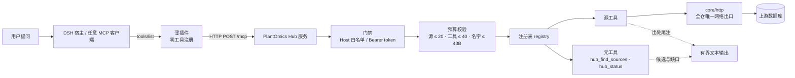
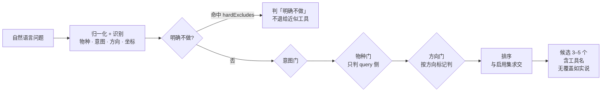
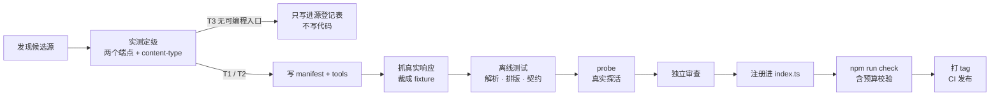
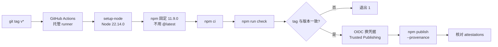

# 机制说明：一次调用怎么走，加一个源要过什么

> 本文件讲**运行时机制与验收流程**；为什么这么设计见 [架构](架构.md)，工具与安装见 [README](../README.md)，源状态见 [源登记表](源登记表.md)。
> 图中 Mermaid 为源文件，渲染产物另行生成，不在此处内嵌图片。
> 数字口径以 `npm run stats` 与 `/healthz` 为准，本文不写死当前计数。

---

## 一、全景：一次工具调用经过什么



要点：**插件里没有任何工具**。工具清单由服务在 `tools/list` 时给出，所以加源不需要用户重装插件——这是 0.1.0 改形态的唯一目的。

---

## 二、三层边界

| 层 | 位置 | 负责 | 不负责 |
|---|---|---|---|
| **契约层** | `src/core/` | 类型、HTTP、注册表硬校验、输出排版、请求预算 | 具体某个源的字段含义 |
| **适配层** | `src/sources/<id>/` | 一个源一个目录：`manifest.ts` + `tools.ts` + `fixtures/` | 跨源编排、协议 |
| **出口层** | `src/mcp/` `src/dsh/` `src/service/` | 把同一份 `ToolDefinition` 翻译成 stdio MCP / DSH 插件 / HTTP 服务 | 任何源逻辑 |

三条不允许越界的规则：

1. **源目录不许直接发网络请求**，必须走 `core/http`。否则超时、UA、重试、错误分类会各写一份。
2. **出口不许改工具定义**。同一份 JSON Schema 喂给两个出口，schema 只有一份真相。
3. **服务层不许读 `dist/`、不许探测上游**。`/healthz` 与检索层都只读运行时注册表。

---

## 三、服务层：无状态、可水平扩容

- 每条请求独立新建 server + transport，**没有跨请求会话**。因此不需要会话亲和，可以直接多副本。
- 半截 POST、畸形 `Host`、超大正文都按门禁处理：正文超 1 MiB → 413，读取超 15 s → 408，`Host` 不在白名单 → 403。这些不是"防御性编程"，是压测时真踩到的。
- `/healthz` 免鉴权、免 `Host` 校验，返回 `status / version / package / sources / tools / metaTools`。它回答"服务活着且装配了几个工具"，**不回答上游是否可用**。
- 绑非回环地址时配置层强制要求 token；反代场景要把域名写进 `PLANTOMICS_HUB_ALLOWED_HOSTS`，否则一律 403。

环境变量：`PLANTOMICS_HUB_HOST` / `PORT` / `TOKEN` / `ALLOWED_HOSTS` / `LOG` / `SERVER_NAME`。

**按请求选源（源市场的第一步）**：请求头 `x-plantomics-sources: icg,scod`，解析与环境变量 `PLANTOMICS_SOURCES` 共用
`parseSourceList()`（同一件事只许有一种切法）。两级约束：

```
PLANTOMICS_SOURCES（服务端能给的）  ⊇  x-plantomics-sources（这次请求选的）  ⊇  ∅
```

- 不带该头 / 头为空 → 直接用服务端注册表，**行为与没有这个功能时完全一致**（兼容既有插件）；
- 未知 id（注册表根本没有）→ `400 invalid source subset`，`detail` 点名并列出已登记源；
- 有但未启用 → `400`，说明本服务启用了哪些——请求头**不能扩张**服务端策略；
- 子集注册表由 `createRegistry({ enabled })` 装配，`hub_*` 元工具跟着走；`/healthz` 报的始终是服务端全集。

**两条必须写明的性质**（写错会让读者高估它的安全性）：

1. **不是权限隔离，是上下文预算手段。** 服务无状态、**每条请求各自判断**：同一客户端下一条请求不带这个头，
   照样拿到服务端全集。"按连接"是错误说法——没有会话可依附。要控访问权得另做鉴权设计。
2. **`initialize` 的 `instructions` 随子集变化，是有意设计**：写明本次请求启用的源数与工具数，并在子集时多一行
   "本请求只启用了部分源"。客户端缓存握手结果时，该文案只对那次请求成立。

实现要点：子集在**读请求体之前**解析（拼错的 id 不该先吃满一个请求体），复用 `createRegistry` 而不是另写过滤，
所以工具名、预算、元工具规则都只有一份。每条请求新建注册表的实测成本约 **6 微秒**（2000 次 11.8 ms），
不需要缓存，也就没有"缓存把上一个用户的子集带给下一个"的风险（服务本身无状态）。


---

## 四、元工具：为什么不占源数

`hub_find_sources` 与 `hub_status` 用 `hub_` 前缀，注册在独立装配点（`src/retrieval/index.ts`），不挂在任何源下。

| 计数口径 | 元工具算不算 |
|---|---|
| 源数（≤ 20） | **不算** |
| 工具数（≤ 40） | **算** |
| `/healthz` | 单列 `metaTools` |
| 工具名长度预算（43 B） | **算**，`hub_` 前缀同样吃字节 |

不把它们伪装成"某个源的工具"，是因为那样要给它编造 `intents`、`speciesScope` 等源侧字段，等于往注册表里塞伪数据；而"双向一致"的校验只对源工具成立。

---

## 五、检索层：四道门 + 三个已修的坑



三个曾经真出错、现在有回归锁定的点：

1. **目标域要按分句绑定**。判"目标物种是否被覆盖"时，只在**同一分句**里同时出现同源类关键词与该物种才算同源目标。否则「小麦同源基因，另外玉米内参基因有哪些」会把玉米当成同源目标，误挡小麦同源工具。
2. **坐标形态要在原始文本上判**。`normalize()` 会把 `:`、`-` 换成空格，`chr1A:100000-200000` 归一化后只剩空格分隔的数字；只在归一化文本上找"区间/坐标"二字必然漏。
3. **候选必须先与启用集求交**。子集注册表下若推荐未启用的工具，用户点了就是 404；求交之后未注册工具既不进候选、也不进缺口。

输出约束：正文 1408 B、回显 1536 B、整包 ≤ 4 KB；截断只裁正文，**免责行与出处尾注不可被切**，放不下就报错，不返回残缺的成功结果。

---

## 六、加一个源要过什么



每步的"什么算通过"：

| 步骤 | 通过标准 | 不通过时 |
|---|---|---|
| 定级 | 有 `docs` 地址（T1）或写明 URL 模式与反例（T2）；T3 写明试过什么、卡在哪 | 归 T3，只登记 |
| 实现 | 工具名 `<sourceId>_<动词短语>`；描述写"何时该用"与覆盖盲区 | 改描述，不靠调用方猜 |
| fixture | 真实响应的裁剪版，含空结果与结构漂移反例 | 不许用合成数据冒充实测 |
| 离线测试 | `npm test` 全离线通过；无真实网络请求 | 补 fixture，不给测试加网络 |
| 探活 | `npm run probe` 退出 0，逐源给出状态码与耗时 | 记录失败原因，不猜"上游重启" |
| 独立审查 | 别人按证据复核，覆盖空结果/漂移/预算/隐私 | 修完再审 |
| 集成 | `npm run check` 退出 0；`stats` 显示源 ≤ 20、工具 ≤ 40 | 到 40 就先上检索层，不加源 |

**工具数到 40 之后怎么走**：不再常驻新增工具，改为经检索层按需展开。判据是 `npm run stats`，不是"每源 4–8 个"的估算。

---

## 七、发布链路



四个已经踩过的坑，都写进了 workflow：

1. **不能装 `npm@latest`**。latest 已是 12.x，engines 要求 Node ^22.22.2，而 runner 是 22.14.0，直接 EBADENGINE。固定 `11.9.0` 才稳。
2. **必须先 `npm run check`**。包内 `files` 只含 `dist` 等少数条目，不构建就发一个没有 `dist` 的空包。
3. **必须校验 tag 与版本一致**，否则会发出一个版本号对不上的包，npm 上不可撤销。
4. **必须独立核对 attestation**。0.1.0 那次包发出去了、publish 步骤却退出 1，而 registry 上的 attestation 是 404——只看退出码会误判成"没发出去"。

发布与打包是两条线：**npm 包内不含 `src/`、不含 fixture、不含 test**；本机 tgz 只用于自己安装，不能用于 provenance。

发布前后另跑 `npm run check:market`：它要联网核发布包与市场描述，因此**不在** `npm run check` 里（见 §八）。

---

## 八、数字与市场：为什么是两道闸

数字不靠人记得改，靠机器核。2026-10-30 一天之内同一类错误出现两次：README 写「0.1.0 = 8 源 37 工具」，
而 npm 上装出来是 7 源 34 工具；市场索引又写反。根因是手写。现在分三个命令、两个口径：

| 命令 | 联网 | 锁什么 | 什么时候跑 |
|---|---|---|---|
| `npm run check:counts` | 否 | README 标记块、逐源表格、`/healthz` 示例、「全量常驻」句、三处预算常量 vs 本地 `dist` | 每次 `npm run check`（已内置） |
| `npm run check:wording` | 否 | `web/` 把「关闭标签页」写成确定清除即失败；README 与输入框提示必须同时写「通常会清除 / 恢复会话可能保留 / 点按钮」 | 每次 `npm run check`（已内置） |
| `npm run counts:published` | 是 | 市场描述的数量短语 vs npm 最新 tarball 的真实数量（重下载 + sha512） | 发布前后单独跑 |
| `npm run check:market` | 是 | 数字闸 **＋** 措辞闸（见下） | 发布前、改 `market/` 后 |

**两个口径不能互相顶替**：源码口径（本地 `dist`，源自 `npm run counts`）是"当前源码能力"，给 README 与落地页用；
发布口径（npm tarball，源自 `npm run counts:published`）是"装上能拿到什么"，给市场索引用。发布滞后时两者本来就不同，
把源码数写进市场描述就是承诺装不出来的能力。**具体数字不写在这里**（见本文开头：口径以脚本实测为准）。

**为什么市场要两道闸**（这一条是实测出来的，不是按说明写的）：

| 变异 | 数字闸 | 措辞闸 |
|---|---|---|
| 描述里 `34 个` → `35 个` | ❌ | ❌ |
| 「薄插件」→「插件」（数字没动） | ✅ | ❌ |

数字闸只比对数量短语，句子里其它措辞它根本不管。措辞由 `market/scripts/check-index.mjs`
与 `market/copy.json` 逐字比对来锁。**所以两道同绿才算市场描述被锁住。**

`npm run check:market`（`scripts/check-market.mjs`）是单一入口，但不写成 `a && b`：那样任一道红只给一个
exit 1，跑的人不知道去改数字还是改措辞。它两道都跑，逐道报红并给方向，还区分第三种红——
**取不到发布口径**（网络/registry 失败）不算"描述写错了"，不许拿它去改数字。
另：`check-index.mjs` 依赖的官方校验器 `@deepseek-ai/dsh-plugin-market-index` 已进 devDependency，
不再需要手工 `PLANTOMICS_MARKET_VALIDATOR`，否则"单一入口"会变成"入口 + 一段安装口诀"。

联网闸刻意不进 `npm run check`：没网就等于红灯的话，红灯会被人跳过，等于没有检查。

---

## 九、这套机制不能保证什么

- 不能保证上游一直活着：`/healthz` 与面板都不做实时探活。
- 不能保证工具名一定被宿主显示：名字超预算会被静默截断，所以有 43 B 硬校验。
- 不能保证模型一定选对工具：检索层只给候选与缺口，最终选择在模型侧。
- 不能把"面板显示全量清单"当作"当前启用了这些源"——清单是构建期快照。
