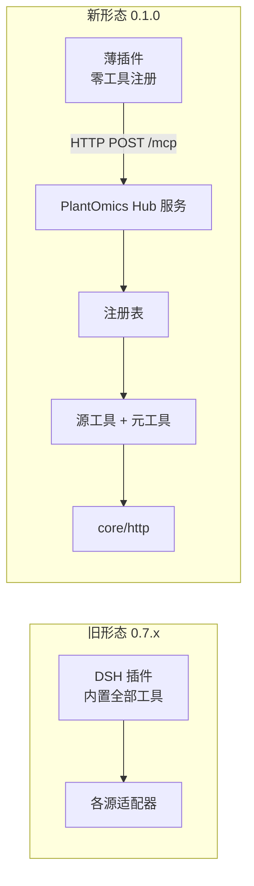

# 架构与关键决策

> 本文件记**为什么这么搭**。工具与安装说明见 [README](../README.md)，源状态见 [源登记表](源登记表.md)。
> 只记"将来重新选一次可能还会争论"的决定；纯实现细节看代码注释。

---

## 1. 三层，一份注册表，两个出口

```
① 注册表层  src/core/        契约（types）、HTTP 客户端、注册表硬校验、输出排版
② 适配层    src/sources/<id>/  一个源一个目录：manifest.ts + tools.ts + fixtures/
③ 出口层    src/mcp/ src/dsh/  同一套 ToolDefinition，翻译成两种协议
```

**为什么强调"一份定义两个出口"**：如果 MCP 侧用 zod 描述参数、DSH 侧用 JSON Schema 描述参数，
两份 schema 必然漂移，而漂移的表现是"某个客户端里工具参数不对"——这种 bug 极难在本地复现。
所以 `ToolDefinition.parameters` 是**纯 JSON Schema**，两个出口都直接吃它。

---

## 2. 决策：参数用纯 JSON Schema，不引 zod

- **代价**：MCP 要用低层 `Server` 手写 `tools/list` / `tools/call`（约 100 行）。
- **收益**：少一个依赖；schema 只有一份；DSH 侧零转换。
- **当时的替代方案**：用 `McpServer.registerTool` + zod，另写一个 zod→JSON Schema 的转换给 DSH。
  否决理由：两套 schema 就是两套真相，且 zod 版本升级会同时动到两边。

---

## 3. 决策：单包多入口，不做 monorepo

- `main` / `exports["."]` → `dist/dsh/index.js`（DSH 插件入口）
- `exports["./mcp"]` → `dist/mcp/server.js`（可被程序化 import）
- `bin.plant-omics-mcp` → `dist/mcp/cli.js`（stdio 入口）
- `package.json` 的 `dsh.bundle.patch` → `cordis.patch.yml`

**理由**：维护者只有一个人。monorepo 的收益（独立版本、独立发布）在这个规模上是负的，
而代价（`pnpm link`、跨包类型解析、两处 `node_modules`）是立刻要付的。
**等真的要拆时再拆**——拆的时候 `src/core` 本来就边界清晰。

---

## 4. HTTP 层：三个必须显式处理的坑

`src/core/http.ts` 是全仓唯一的网络出口。三条规则都有具体来历：

| 规则 | 为什么 |
|---|---|
| **强制超时**（默认 20 s，可用 `timeoutMs` 覆盖） | 国内站点偶发挂起，工具会干等，模型侧看起来像卡死 |
| **带固定 UA** | 部分站点 WAF 直接掐空 UA / curl UA；UA 带工具名，对方日志里能认出我们 |
| **重试只对网络错误 / 5xx / 429** | 4xx 重试只会重复挨骂，且会把限流打成更严重的限流 |

退避是**确定性**的（0 / 400 / 1200 ms），不用随机 —— 测试里可预期，行为可复现。

错误信息按状态码分类，特别是 **502/503/504 会明说"对面后端的问题，不是你的配置问题"**。
这条是 2026-10-27 被真实 503 事件逼出来的（见 `docs/源登记表.md` §四）。

**代理**：不内置。Node ≥ 24 的 `NODE_USE_ENV_PROXY=1` 够用，不为代理引依赖。

---

## 5. 输出设计：工具输出是"给人看的成品"，不是 JSON 的壳

工具输出须按 UTF-8 字节有界、保留完整查询出处、避免透传原始 JSON，实现上靠：

- `src/core/format.ts` 的 `renderTable` / `renderFields` / `provenance`；
- 每个工具的 `run()` 自己决定**裁到多少**（`maxRows`、`maxCell`、前 N 条条件）；
- `ToolResult.raw` **不进模型上下文**：WheatOmics/Strawberry 保留上游结构；GWH/ICG 为隐私白名单投影，不是上游原体，不保证完整字段、原始条目数量或无损重建。已识别联系人键不进入投影，邮箱字符串置 null；无标签电话、微信、自由文本人名不在自动检查范围。

反例与正例（同一个端点）：

- ❌ 把 `/expression/projects` 的 600 KB 原样返回 → 上下文直接爆；
- ✅ 返回"共 N 个项目" + 按 group 汇总表 + 关键词命中前 20 条 → 1 KB 以内，信息密度更高。

---

## 6. 注册表硬校验：故意让进程崩

`src/core/registry.ts` 在 `register()` 时校验：id 规范、`apiBase` 不许带尾斜杠、
工具名必须带源前缀、T1 必须有 docs、**T3 不许挂工具**、T1/T2 不许空手进来。

校验失败**抛异常**，不是打警告。理由：
静默失效比报错危险。一个 T3 源被硬塞了工具，用户拿到的是"接口 404"而不是"这个源本来就没有接口"，
后者能让人五分钟内判断清楚，前者可能耗掉一下午。

---

## 7. 测试分两层，红的原因必须能一眼分开

| 层 | 联网 | 红了 = |
|---|---|---|
| `npm test` | 否（fixture 回放 + 内存传输） | 我们的代码坏了 |
| `npm run probe` | 是 | 上游坏了 |

**`npm test` 里出现真实网络请求视为缺陷。** 联网测试会因为上游改版、机房抖动、代理没开而红；
红了三次之后人就开始 `--skip`，最后等于没有测试。

fixture 是**真实响应的裁剪版**（见 `src/sources/wheatomics/fixtures/README.md`），
只保留断言用得到的字段量级，不保留全量——全量 fixture 会让 PR diff 变成几千行噪音。

---

## 8. 扩展点（加东西时只看这两处）

| 要加什么 | 改哪里 | 清单 |
|---|---|---|
| **一个数据源** | `src/sources/<id>/` + `src/sources/index.ts` 加一行 | [`新增一个源.md`](新增一个源.md) |
| **一个出口**（比如再加一个 HTTP API） | 新建 `src/<出口>/`，消费 `registry.listTools()` 即可 | 无需改 core |

---

## 9. DSH 客户端半边：手写 bundle + 构建期静态清单（2026-10-28）

插件不只有工具，还有一个**浏览器半边**：侧边栏「组学」入口 + 一个面板。四个决定都值得记下来。

**① 为什么能加**：DSH 的客户端模块系统会扫已启用的 Loader 条目，认 `dsh.client` + `exports["./client"]`，
把 bundle 经 `/plugins` 送到页面；bundle 执行时只 `window.__ModuleLoader__.load({ id, factory })`，
副作用都在 factory 里。id **必须等于 Loader 条目的包名**，否则 web boot 只报一句
`loaded without registering "<id>"`，人很难看出是哪个包的问题——所以构建脚本会断言这件事。

**② 为什么手写、不引 bundler**：官方 `clientBundle` 构建预设没随包发布（`dsh-client-ui-settings-plugins`
的 README 明说仓外插件得自行复刻），而本插件只 `require` 平台表里的 `react` / `react-dom`。
照先例手写一个文件 + 一个注入步骤，比引 esbuild 更小、更可审计，也不破坏「零运行时依赖」。
顺带避开了纯净度门禁：外部插件不得以值的形式 import `@deepseek-ai/*` 的 UI 包，所以样式与组件自持。

**③ 为什么注册 `sidebar.footer.action` 而不是 `sidebar.settings`**：后者是 single slot，已被 settings-general
占用；抢占它等于把设置入口弄坏。`sidebar.footer.action` 是 list slot，官方 cordis 面板就注册在这里，
是唯一「第三方可加、又不侵占别人」的位置。收起到 56px 轨道时槽位传 `{ wide: false }`，入口只显示徽标。

**④ 为什么只放静态清单**：首版不引入「客户端 ↔ 宿主」传输（远程方法或自定义 HTTP 路由），
面板的数据全部来自**构建期**从注册表生成的清单，顶部固定写明「静态快照 · 源码 <提交> · 源码时间 … · 包版本 … · 不表示上游当前可用」。时间戳不由墙钟生成：默认取 git 提交时间，`SOURCE_DATE_EPOCH` 可覆盖，二者都没有时写"未知"；同时记录 `sourceRev`（短 sha，已跟踪文件有改动时加 `-dirty`）。这样同一源码状态两次构建产出相同字节，`dist` 才能与已发布包做字节比对（2026-10-28 改）。
把构建期快照显示成运行状态，比不显示更糟——用户会以为「面板说能查 = 上游现在活着」。
`lastProbe` 因此**刻意不进清单**；可达性仍只由 `npm run probe` 回答。

**代价与已知风险**：

- 清单不随运行时变化：改了启用源（`PLANTOMICS_SOURCES` / 插件 `sources` 配置）后，面板仍显示全量清单。
- 槽位名、`ctx.effect`、`require('react')` 的平台表都属于宿主契约；宿主升级后若改名，表现是入口静默消失。
  排查入口应与 `npm run check` 一起跑。
- 侧边栏折叠/展开会重建槽位，面板的开关状态可能丢失（首版接受）。
- 真实宿主里「入口可见、页面可打开」必须装机后由人确认；`test/client.test.ts` 只证明形状与文案。

## 10. 完整请求预算与源级probe（0.4.0源码候选）

出处不能靠哈希、前三个ID或300字符截断代替请求。共享request助手在网络之前生成同一份完整GET绝对URL及本地呈现选项，按最终UTF-8字节检查1536B上限；超出直接拒绝，要求拆批或缩短筛选。WheatOmics也走同一入口，旧版名义ID上限不变，但字节上限会收紧部分调用，须在迁移说明明示。

全尾注预留2560B，正文最多1408B，只允许裁正文；异常响应元数据使尾注溢出则明确失败。共享provenance移除请求省略。HTTP错误携带完整预检request，MCP与DSH使用同一describeError；原始响应正文不进入错误文本。

probe验证器属于SourceBundle而非客户端清单：注册表必须保留该可选函数，脚本在HTTP/JSON/通用信封检查后调用源级断言。Strawberry的genes/status须enabled/available均为布尔true、examples及字段类型有效；正常用真实fixture，禁用/不可用/漂移/429用明确标注模拟反例。导入脚本不联网或落盘，CLI失败非零退出。一个状态端点通过不代表五个业务工具全可用。

首版不增加POST，也不加无消费方的tags字段。分类先放工具描述与README：物种覆盖、数据类型、查询意图分别陈述，源、官方MCP、公开API、本仓工具不重复计数。侧边栏保持现状，新构建清单变化不等于已安装包自动更新。

## 11. 0.1.0 形态变更：薄插件 + 远程 MCP 服务

**这是本仓唯一一次破坏性架构变更**：包名 `dsh-plugin-plant-omics` → `plantomics-hub`，插件从"内置工具"变成"零工具外壳"，工具改由服务在 `tools/list` 时下发。



**为什么非改不可**（三条压力同时到）：

1. **加一个源就要重装一次插件**。用户装完还得重启宿主、新开会话，加源频率一高就不可用。
2. **工具数被宿主名字预算卡死**。公开名上限 64 B，扣掉 `mcp__plantomics-hub__` 前缀只剩 43 B，源一多就撞墙；而工具是否注册、注册多少个，本该由服务侧决定。
3. **服务可以水平扩容**。无状态之后多副本直接跑，插件侧不需要任何会话亲和。

**代价（接受）**：

- 插件单独存在时**没有任何工具**，必须先起服务；这是"能装不能用"的典型形态，README 里必须写在最前面。
- 多了一个需要运维的常驻进程与一个端口。
- 破坏性变更：旧包与新包不可同时启用，安装说明必须重写。

**被否决的替代方案**：

| 方案 | 否决理由 |
|---|---|
| 插件内置工具 + 服务动态下发**代码** | 等于在用户机器上执行远端下发的代码，供应链风险不可接受 |
| 插件内置工具 + 服务只下发**清单** | 清单与实际工具仍要两处维护，加源还是要重装 |
| 加一个 `hub_call` 万能执行器绕开工具数 | 绕过预算与 schema，模型拿不到参数约束，出错无法定位 |

**无状态是刻意的**：每条请求独立新建 server + transport，不为省一次握手引入会话表。0.2.0 若要支持 `list_changed` 通知（依赖 GET SSE 长连接），才需要引入有状态会话，届时须同时解决会话隔离、内存上限与预算拒绝，五条准入缺一不算通过。

**元工具与源工具分开计数**：`hub_find_sources` / `hub_status` 计入 40 的工具预算、不计入 20 的源预算，`/healthz` 里单列 `metaTools`。机制细节见 [机制说明](机制说明.md)。

## 12. 文档出图管线（Mermaid，2026-10-30 实测）

图分两类，别混：**随文发布的图直接内联**在 `docs/架构.md`、`docs/机制说明.md` 的 ```mermaid 代码块里（当次发布的就是它）；`docs/figures/*.mmd` 是**工作仓草稿**，公开仓尚未跟踪、也无任何文档引用，出图产物一律不入库。

**渲染工具按需调用，不进 `devDependencies`**（`npx` 首次会下载 Chromium，本机实测约 641.7 MB，只落本机缓存）：

```powershell
# 已装则直接用；未装则改用 npx @mermaid-js/mermaid-cli
.\node_modules\.bin\mmdc.cmd -i docs\figures\fig1-系统架构.mmd -o fig1.svg
.\node_modules\.bin\mmdc.cmd -i docs\figures\fig2-加源流水线.mmd -o fig2.png -s 2
```

四条实测约束（2026-10-30）：

1. **`mmdc` 不接受 `-w`**（报 `unknown option '-w'`），要放大只能用 `-s <倍数>`。
2. **横向长链在 1x 下不可读**：加源流水线图单链 `LR` 渲染出来 1x 只有 784 × 84（1:9 的细条），纯 `TB` 是 563 × 2296（1:4 的细长条）；改成"两个 `direction LR` 子图"的两段式后为 784 × 342，宽度与 fig1 的 784 对齐。**排布先量尺寸再定，不要等出图才发现读不了。**
3. **渲染结果只能做文本与结构层核对**：抽 SVG 里的标签、查 `U+FFFD` 与豆腐块、量宽高，能证明"标签都在、没有乱码、尺寸合理"；**不能替代目视检查**——有没有重叠、好不好看必须由人看图判定。这一点在只有结构化输出、看不到图像的会话里尤其要写在交付说明里。
4. `mmdc` 曾进过 `devDependencies`，使 `npm audit` 从 3 项升到 5 项并多出 2 个 critical，**已回退**；现状态见 [安装验证](安装验证.md)。
